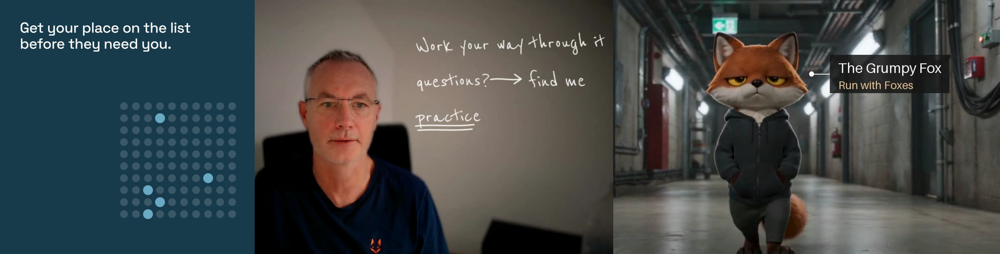
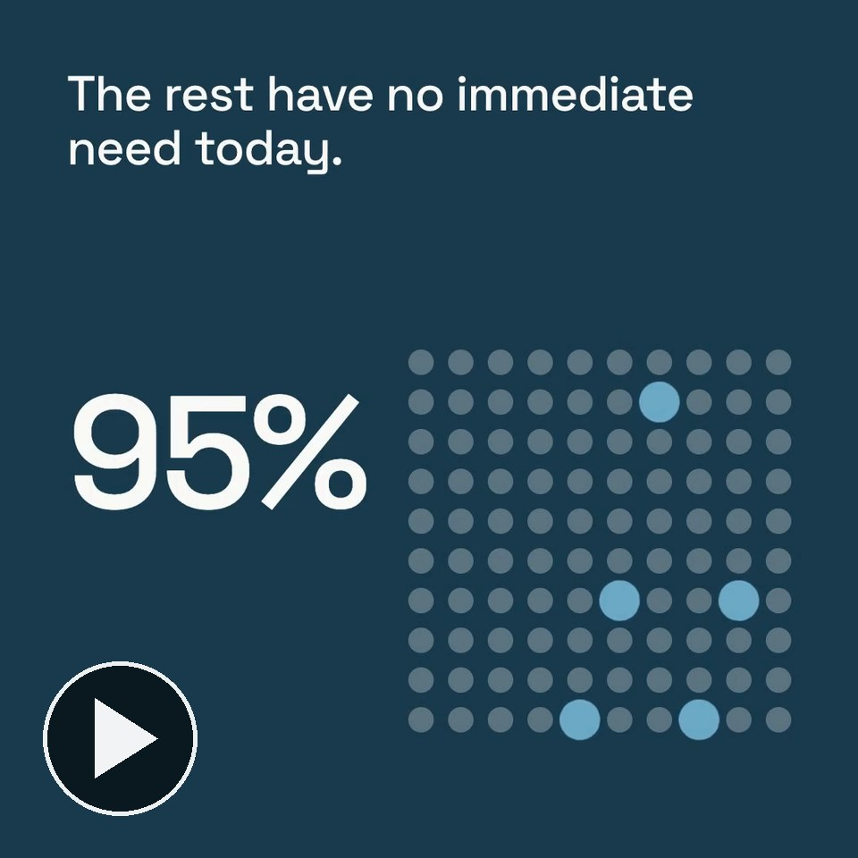
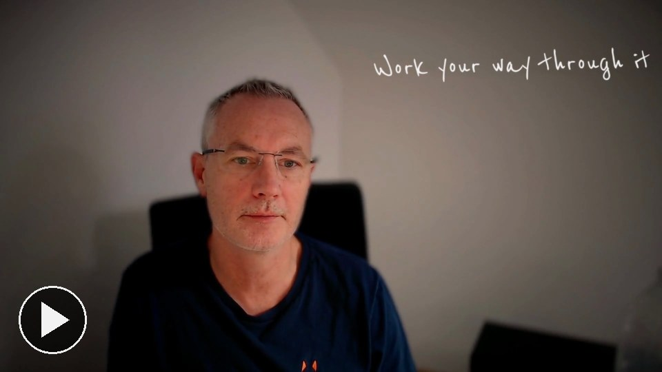
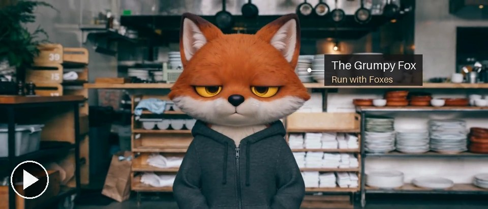
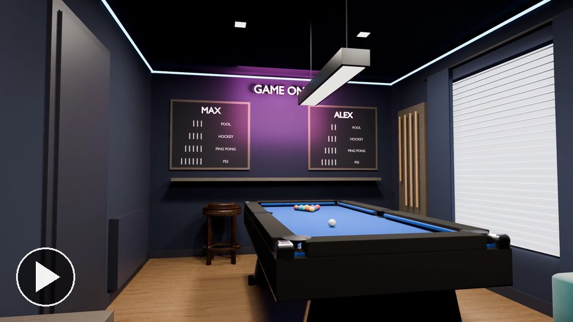

# Motion skills for Claude

These are the ways we make motion in code: films where every frame is worked out by a program rather than drawn by an
AI model, so a number, a colour or a timing comes out the same every time. Each one is a skill you can give Claude.

I'm Paul Dervan. I run Run with Foxes, where we build AI agents for marketing teams, and I teach marketing at UCD.
These came out of making short films for our own posts and our course. None of them needs a paid key.

## The skills

| Film | Skill and what it makes |
|---|---|
|  | **[motion-by-numbers](../skills/motion-by-numbers)** Start here. The method behind all of them: a brief in eight lines with numbers in place of adjectives, every frame worked out from time, faults fixed by frame number, sound made in code. |
|  | **[beat-reel](../skills/beat-reel)** A 15 second graphic reel where every change lands on a beat, and the music is made from the same beats. |
|  | **[handwriting-on-video](../skills/handwriting-on-video)** White pen writing drawn on the wall beside someone as they talk, each word landing as they say it. |
|  | **[tracked-label](../skills/tracked-label)** A label pinned to something moving in real footage, followed through every shot: the After Effects tracking job, in code. |
|  | **[3d-room-with-claude-and-blender](../skills/3d-room-with-claude-and-blender)** A real room built in Blender to the centimetre from phone photos and a tape measure, then shot as a 30 second film from the model. |

Click a picture to play the film with sound. Every skill folder has a short README with the film, and a SKILL.md with the method.

## How to use them

In Claude Code, copy `motion-by-numbers` and the skill you want into `.claude/skills/` in your project, or into
`~/.claude/skills/` to have them everywhere. Then ask in plain words: "make a 15 second reel of this chart, cut to a
beat".

The beat reel and the handwriting render with HyperFrames, HeyGen's open source engine. Install it in the folder you
work in with `npm i hyperframes@0.8.143 --ignore-scripts` and render through the `render.sh` in motion-by-numbers,
which turns off its usage reporting. You also need Python 3 and ffmpeg. The tracked label needs OpenCV.

## A few things worth knowing

A script passing doesn't mean the film is good. Every skill here ends the same way: lay the frames out at a size you
can read and look at them yourself, and measure what can be measured.

Time the picture to the beat, not the words. Hold a picture still while a caption is read and the film goes flat.

## Credits

Motion by numbers grew from Florence's (@flxrnc) article on motion design with Claude and rari's (@0xwhrrari)
"Motion Engineering". The beat reel's method came from Sunwood AI Labs'
[hyperframes-motion-reel-skill](https://github.com/Sunwood-ai-labs/hyperframes-motion-reel-skill), MIT licence,
Copyright (c) 2026 Sunwood AI Labs. The handwriting was inspired by Hector Serrano's videos and the titles in Guy
Ritchie's The Gentlemen. The tracked label uses OpenCV's CSRT tracker. Everything renders with HyperFrames by HeyGen
(Apache 2.0) and ffmpeg. The 95:5 rule in the beat reel is John Dawes' work at the Ehrenberg-Bass Institute.

For the fox films (Rounders freeze frames, a Goodfellas walk, a Cannes trailer, a Tarantino trunk shot), see
[fox-film-skills](https://github.com/runwithfoxes/fox-film-skills). For the marketing skills from my course, see
[marketing-skills](https://github.com/runwithfoxes/marketing-skills).

## Licence

The code and the written method are under the [MIT licence](LICENSE). The fox is not: the Grumpy Fox and every
picture and film of him in this repo belong to Run with Foxes.
