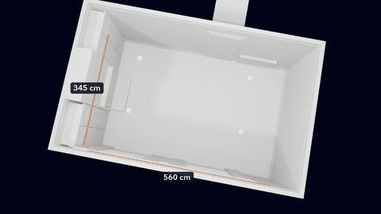

# Build a 3D room with Claude and Blender

[Play the film, with sound](../../assets/films/3d-room-with-claude-and-blender.mp4).

A real room built in Blender to the centimetre from phone photos and a tape measure, then shot as a 30 second film
from the model. [Watch it with sound](../../assets/films/3d-room-with-claude-and-blender.mp4).

How to make one is in [SKILL.md](SKILL.md). The scripts are the worked example, a living room turned into a games room,
and the template: change the sizes in `room.py` and the furniture in `layout.py`, keep the rest. No key and no cost.

How we made it, with the full story: [A real room, built to the centimetre in Blender](https://runwithfoxes.com/craft/a-real-room-built-to-the-centimetre).
