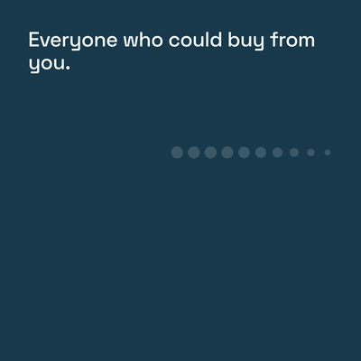

# Beat reel

A 15 second graphic reel where every change lands on a beat, and the music is made in code from the same beats.
[Watch it with sound](../../assets/films/beat-reel.mp4).

How to make one is in [SKILL.md](SKILL.md). `build.py` is the worked example, the 95:5 rule in 100 dots, and the
template: change the shots and the drawing, keep the rest. No key and no cost.

The method came from Sunwood AI Labs' [hyperframes-motion-reel-skill](https://github.com/Sunwood-ai-labs/hyperframes-motion-reel-skill)
(MIT, Copyright (c) 2026 Sunwood AI Labs). Rendered with HyperFrames by HeyGen. The 95:5 rule is John Dawes',
Ehrenberg-Bass Institute.
