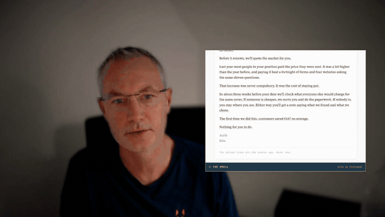

# Handwriting on video

[Play the film, with sound](../../assets/films/handwriting-on-video.mp4).

White pen writing drawn on the wall beside someone as they talk, each word landing as they say it.
[Watch it with sound](../../assets/films/handwriting-on-video.mp4).

How to make it is in [SKILL.md](SKILL.md). `build.py` writes the writing as a page, `compose.sh` renders it and lays
it on the film. No key and no cost.

Inspired by Hector Serrano's videos and the titles in Guy Ritchie's The Gentlemen. Rendered with HyperFrames by
HeyGen. Font: Reenie Beanie, SIL Open Font Licence.
