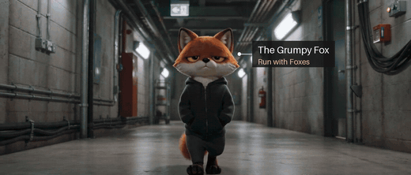

# Tracked label

A label pinned to something moving in a real film, followed frame by frame through every shot, the job After
Effects' tracker does. [Watch the whole film](../../assets/films/tracked-label.mp4): corridor, kitchen, stage.

How to make it is in [SKILL.md](SKILL.md). `cuts.py` finds the shots, `track.py` follows the object and checks the
track, `render.py` draws the label. Free, and about twenty minutes.

Tracking by OpenCV's CSRT tracker. Drawn with Pillow, put together with ffmpeg.
